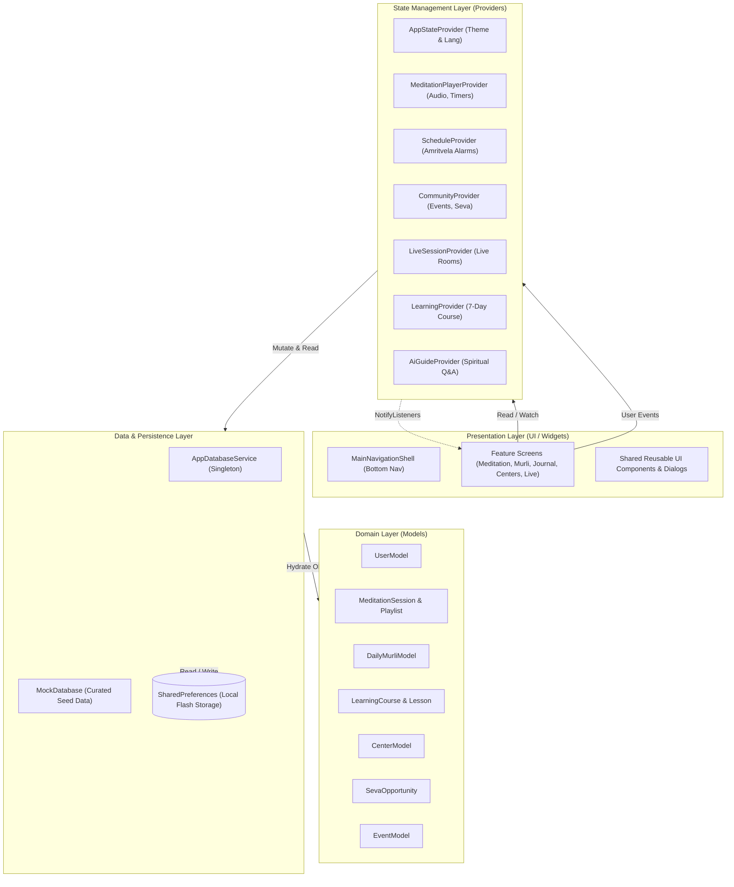
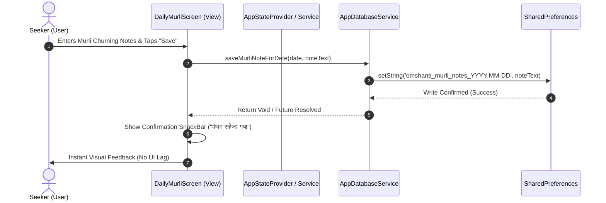
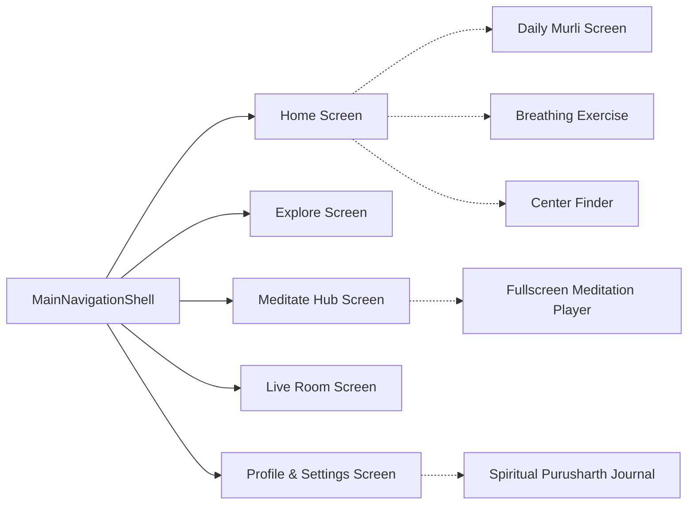

# System Architecture & Technical Design Document — Om Shanti (ॐ शान्ति)

> **Document Version:** 1.0.0  
> **Status:** Active / Production Architecture  
> **Pattern:** Feature-First Clean Architecture with Unidirectional Data Flow  
> **Engine:** Flutter & Dart Multiplatform

---

## 1. Architectural Philosophy (The "HOW")

The architecture of **Om Shanti** is engineered around three core principles:
1. **Feature-First Modularity (Domain-Driven Organization):**
   Instead of organizing the codebase by technical layer (e.g., throwing all screens into one `screens/` folder and all logic into a `services/` folder), code is organized by **Feature Domain** (e.g., `features/meditation`, `features/murli`, `features/journal`, `features/centers`). This guarantees that each module is self-contained, easy to reason about, and simple to test or refactor.
2. **Unidirectional Data Flow (UDF):**
   State always flows downwards from Providers into Widget Consumers. User interactions trigger methods on Providers, which manipulate domain services or local persistence, and notify listeners to selectively trigger rebuilds.
3. **Decoupled Offline-First Storage:**
   Data access is mediated through a single asynchronous service (`AppDatabaseService`), ensuring presentation screens never interact with raw storage APIs directly.

---

## 2. High-Level System Architecture Diagram



---

## 3. Unidirectional Data Flow & State Lifecycle



---

## 4. Codebase Anatomy & Directory Structure

```
omshanti/
├── pubspec.yaml               # Dependencies, SDK constraints & Asset declarations
├── README.md                  # Project overview & quickstart landing page
├── PRD.md                     # Product Requirements Document (What & Why)
├── TECH_STACK.md              # Technology stack, package rationale & matrix
├── ARCHITECTURE.md            # System architecture & structural blueprint (How)
│
├── assets/                    # Static image assets, logos, and illustrations
│   └── images/
│
└── lib/
    ├── main.dart              # Application entry point & MultiProvider registration
    │
    ├── core/                  # Shared infrastructural code across the whole app
    │   ├── constants/
    │   │   ├── app_colors.dart        # Sacred spiritual Brahma Kumaris color palette
    │   │   ├── app_spacing.dart       # Standard paddings, margins & border radii
    │   │   ├── app_strings.dart       # Bilingual localization dictionary (EN & HI)
    │   │   └── app_typography.dart    # Google Fonts typography tokens
    │   ├── routes/
    │   │   └── app_routes.dart        # Central named route registry & navigator key
    │   ├── services/                  # Platform & notification bridge services
    │   ├── theme/
    │   │   └── app_theme.dart         # Material 3 light & Paramdham dark ThemeData
    │   └── utils/                     # Formatting utilities & math helpers
    │
    ├── data/                  # Data access and local database services
    │   ├── app_database_service.dart  # Offline SharedPreferences & JSON storage
    │   └── mock_database.dart         # High-fidelity curated spiritual database
    │
    ├── models/                # Strongly typed immutable data domain models
    │   ├── center_model.dart          # Meditation centers & geographical coords
    │   ├── chat_message.dart          # Live room and AI guide messages
    │   ├── daily_murli_model.dart     # Daily Murli discourse structure
    │   ├── event_model.dart           # Spiritual retreats and online seminars
    │   ├── learning_course.dart       # 7-Day Foundation course & lesson items
    │   ├── live_session.dart          # Live collective meditation broadcast sessions
    │   ├── media_item_model.dart      # Peace News & Awakening TV media feeds
    │   ├── meditation_session.dart    # Audio tracks, categories, durations
    │   ├── playlist.dart              # Curated meditation track groupings
    │   ├── resource.dart              # Books, articles, and audio links
    │   ├── schedule_item.dart         # Daily reminder times & practice slots
    │   ├── seva_opportunity.dart      # Selfless community service openings
    │   └── user_model.dart            # User profile, streak count & practice stats
    │
    ├── providers/             # ChangeNotifier business logic and reactive state
    │   ├── ai_guide_provider.dart     # AI spiritual guide Q&A state
    │   ├── app_state_provider.dart    # Theme mode, language, user profile state
    │   ├── community_provider.dart    # Events, seva applications, center filters
    │   ├── learning_provider.dart     # Course progress & lesson completion
    │   ├── live_session_provider.dart # Real-time participants & peaceful chat
    │   ├── meditation_player_provider.dart # Audio controls, ambient layers, chimes
    │   └── schedule_provider.dart     # Amritvela & daily practice alarms
    │
    ├── features/              # Feature-First Modular Screens & Sub-views
    │   ├── assistant/         # AI Spiritual Guide screen
    │   ├── auth/              # Login, Sign Up, and Guest mode screens
    │   ├── centers/           # Global Center Finder & map navigation
    │   ├── explore/           # Explore screen, search, category browsing
    │   ├── home/              # Main dashboard, daily quote, quick player
    │   ├── journal/           # Spiritual Purusharth Chart & Murli Churning diary
    │   ├── learning/          # 7-Day Rajyoga Foundation Course journey
    │   ├── live/              # Live collective meditation room
    │   ├── media/             # Awakening TV and Peace News reader
    │   ├── meditation/        # Fullscreen audio player & Breathing visualizer
    │   ├── murli/             # Daily Murli reader & audio player
    │   ├── navigation/        # MainNavigationShell (Persistent bottom bar)
    │   ├── onboarding/        # First-time introductory carousel
    │   ├── profile/           # User statistics, settings, language/theme toggles
    │   ├── schedule/          # Practice schedule & reminder setup
    │   ├── seva/              # Selfless service opportunities portal
    │   └── splash/            # Animated brand splash screen
    │
    └── widgets/               # Reusable UI components
        ├── meditation_card.dart
        ├── ambient_sound_sheet.dart
        └── custom_button.dart
```

---

## 5. Subsystem Deep Dives

### 5.1 Presentation Subsystem: Shell & Navigation Architecture
The application uses a persistent shell layout pattern via [`MainNavigationShell`](file:///c:/Users/princ/.gemini/antigravity-ide/scratch/omshanti/lib/features/navigation/main_navigation_shell.dart):



* **Bottom Bar Navigation:** Seamless switching across 5 primary roots without discarding navigation history.
* **Modal & Push Routes:** Detailed experiences (Fullscreen player, breathing visualizer, Murli reading) are pushed onto the root navigator with custom transition curves.

### 5.2 State Management Subsystem (`MultiProvider`)
Configured at root in [`main.dart`](file:///c:/Users/princ/.gemini/antigravity-ide/scratch/omshanti/lib/main.dart):
* Global access to seven specialized providers via dependency injection.
* No tightly coupled singleton anti-patterns in UI widgets.
* Granular change notifications ensure only widgets consuming dirty properties rebuild, avoiding unnecessary re-renders of the widget tree.

### 5.3 Storage & Persistence Subsystem (`AppDatabaseService`)
Located in [`lib/data/app_database_service.dart`](file:///c:/Users/princ/.gemini/antigravity-ide/scratch/omshanti/lib/data/app_database_service.dart):
* Asynchronously initialized during app startup before `runApp()` executes.
* Provides robust type-safe serialization methods:
  * `getUser()` / `saveUser(UserModel user)`
  * `getFavorites()` / `toggleFavorite(String id)`
  * `addMeditationMinutes(int minutes)` with automatic daily streak progression logic.
  * `getChartForDate(String date)` / `saveChartForDate(String date, Map data)` for daily self-evaluation records.
  * `getMurliNoteForDate(String date)` / `saveMurliNoteForDate(String date, String note)`.

### 5.4 Audio & Multi-Layer Sensory Engine
The [`MeditationPlayerProvider`](file:///c:/Users/princ/.gemini/antigravity-ide/scratch/omshanti/lib/providers/meditation_player_provider.dart) coordinates three concurrent audio elements:
1. **Primary Voice Guidance Stream:** The recorded commentary or discourse track.
2. **Secondary Ambient Soundscape:** Independent background loop (e.g., Temple Bell, Forest Silence, Tanpura).
3. **Periodic Mindfulness Chime:** Interval timer triggering a sacred chime at 3m, 5m, or 10m intervals to bring the wandering mind back to soul-consciousness.

### 5.5 Localization Subsystem
* Centralized in [`AppStrings`](file:///c:/Users/princ/.gemini/antigravity-ide/scratch/omshanti/lib/core/constants/app_strings.dart).
* Reactive bindings via `AppStateProvider.languageCode`:
  ```dart
  // Example usage in any widget:
  final lang = context.watch<AppStateProvider>().languageCode;
  Text(AppStrings.get('morningMeditation', lang));
  ```
* Supports instant on-the-fly toggling between English (`en`) and Hindi (`hi`).

---

## 6. Performance & Quality Best Practices

1. **Repaint Boundaries & Canvas Optimization:**
   The breathing animation visualizer uses dedicated `CustomPainter` widgets enclosed in `RepaintBoundary` wrappers to prevent dirty layout passes from bubbling up to parent screen widgets.
2. **Const Constructor Discipline:**
   Aggressive use of `const` widgets across static UI trees reduces memory allocations and garbage collection cycles to near zero during scroll operations.
3. **Defensive Null Checking:**
   Strict null assertions and fallback values ensure that corrupted local cache entries or missing network assets fail gracefully without crashing the app.
4. **Clean Code Linter Enforcement:**
   Adherence to `flutter_lints: ^6.0.0` ensures standard Dart idioms, proper disposable lifecycle management (`dispose()` called on all controllers and animation tickers), and prevention of memory leaks.

---

## 7. Developer Onboarding & Extension Guide

### How to Add a New Feature Module (Step-by-Step)
1. **Create Feature Directory:** Create `lib/features/<new_feature_name>/`.
2. **Define Data Models:** If the feature handles unique data entities, create an immutable model in `lib/models/`.
3. **Create State Provider (If Needed):** Add a `ChangeNotifier` in `lib/providers/` and register it in `MultiProvider` in `lib/main.dart`.
4. **Add Local Storage Hooks:** If the feature needs offline persistence, add getter/setter methods in `lib/data/app_database_service.dart`.
5. **Add Localized Strings:** Add English and Hindi string translations in `lib/core/constants/app_strings.dart`.
6. **Register Route:** Declare the route name in `lib/core/routes/app_routes.dart` and map it in the `MaterialApp.routes` map.
