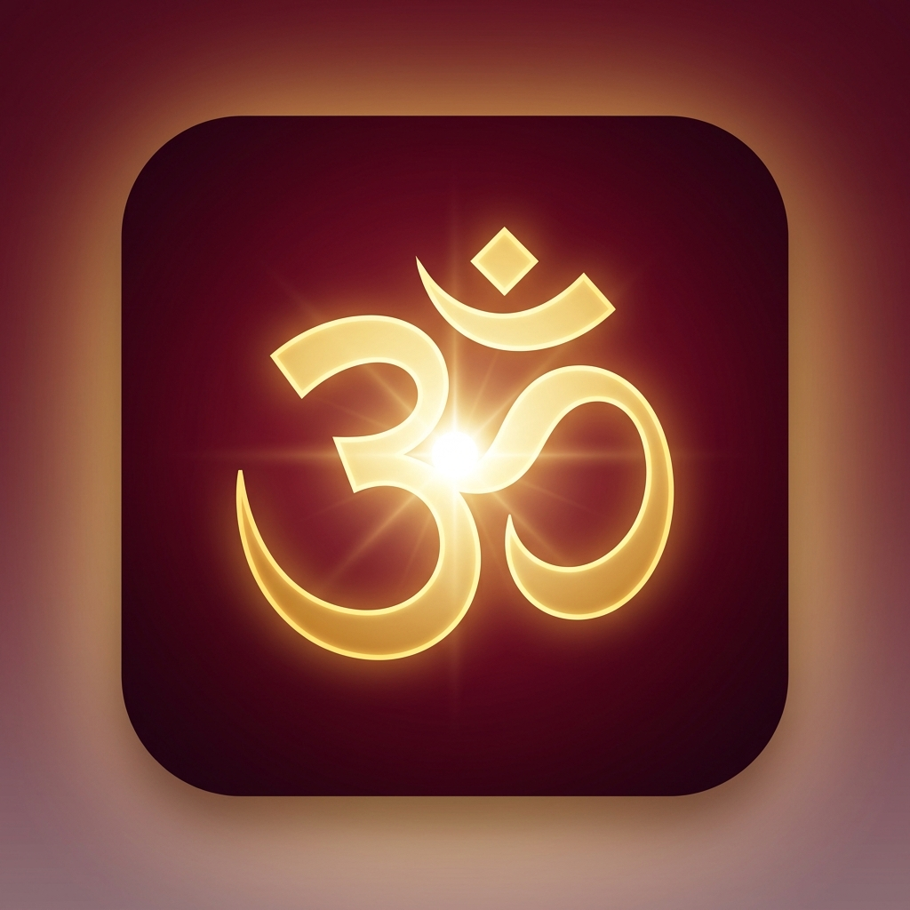
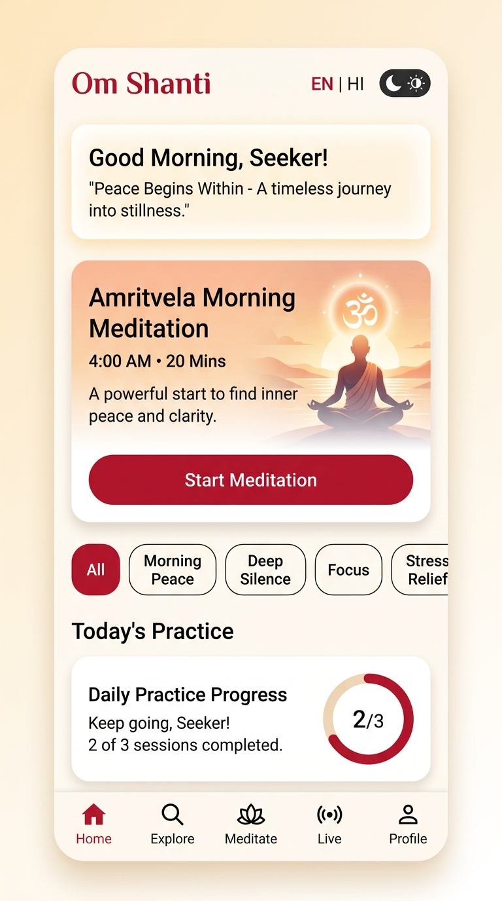
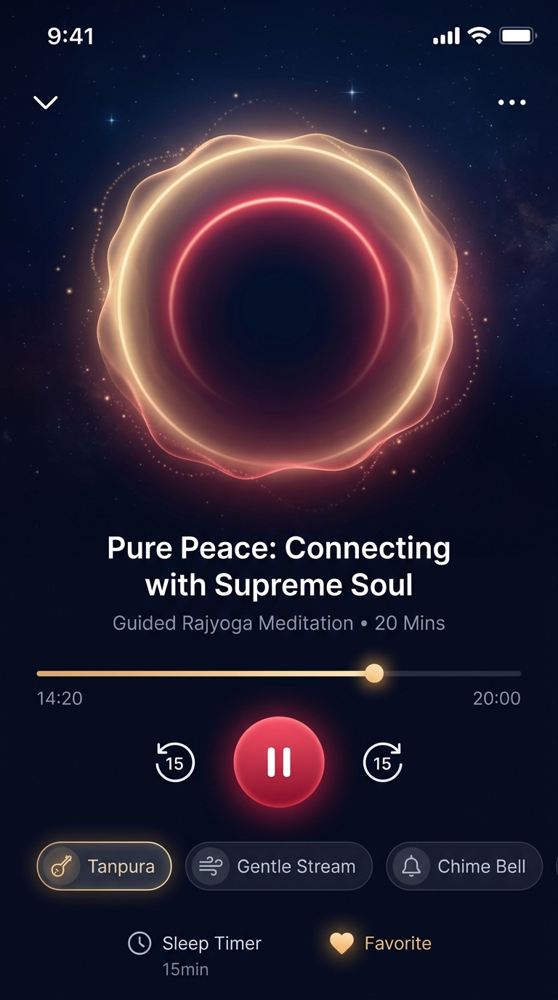
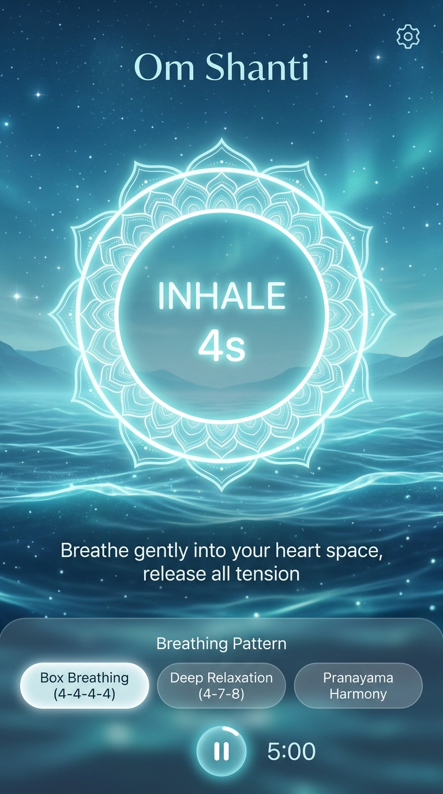
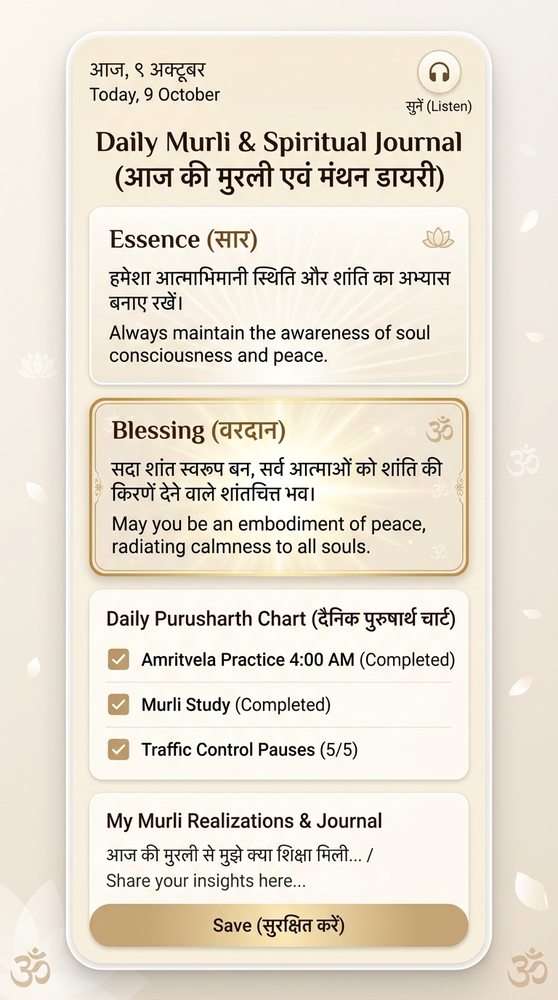
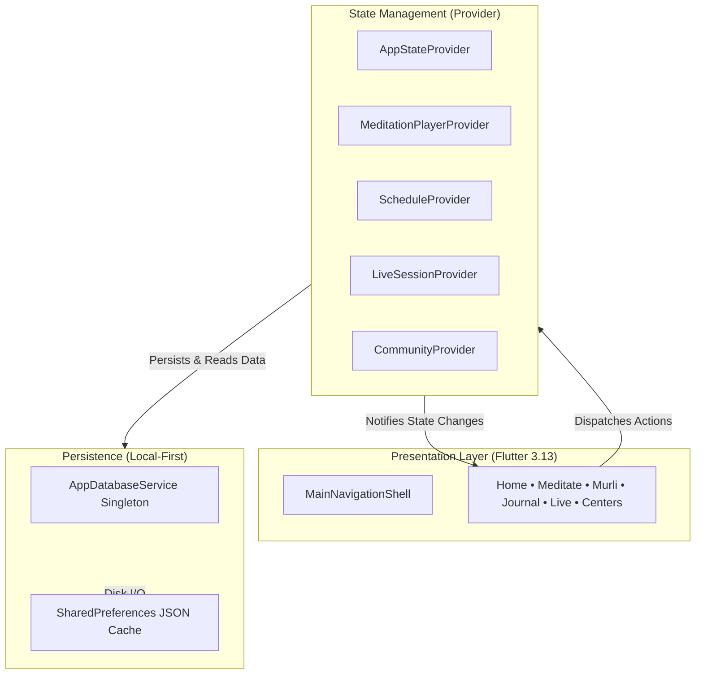

# ॐ शान्ति (Om Shanti) — Digital Meditation & Spiritual Sanctuary

<p align="center">
  <br><br>
  
</p>

<p align="center">
  <strong>Peace Begins Within • शान्ति आपके भीतर है</strong><br>
  <em>An authentic, modern, cross-platform spiritual companion and Rajyoga meditation sanctuary built with Flutter & Dart.</em>
</p>

<p align="center">
  
  
  
  
  
  
  
</p>

---

## 📖 Table of Contents
1. [Core Philosophy & Native Ideas Behind Building This](#-core-philosophy--native-ideas-behind-building-this)
2. [What, Why & How at a Glance](#-what-why--how-at-a-glance)
3. [Visual Walkthrough & Application Screenshots](#-visual-walkthrough--application-screenshots)
4. [Master Documentation Pillars (PRD, Tech Stack, Architecture)](#-master-documentation-pillars)
5. [Feature Matrix & Daily Spiritual Rhythm](#-feature-matrix--daily-spiritual-rhythm)
6. [System Architecture & Tech Stack Summary](#-system-architecture--tech-stack-summary)
7. [Getting Started & Installation](#-getting-started--installation)
8. [Project Anatomy & Directory Layout](#-project-anatomy--directory-layout)
9. [Developer Quality & Verification](#-developer-quality--verification)
10. [License & Acknowledgments](#-license--acknowledgments)

---

## 🕊️ Core Philosophy & Native Ideas Behind Building This

### 1. The Heritage of Rajyoga Meditation
In an era characterized by hyper-connectivity, continuous dopamine loops, and cognitive fragmentation, modern wellness applications frequently reduce meditation to a 5-minute productivity hack hidden behind aggressive subscription paywalls.

**Om Shanti** was conceived from a fundamentally different premise: **meditation is not a temporary relaxation technique—it is an art of spiritual living and self-realization.** Inspired by the universal spiritual philosophy taught by the **Brahma Kumaris World Spiritual University**, this project translates timeless Vedic and Rajyoga disciplines into an intuitive, respectful digital sanctuary:

* **Soul Consciousness (*आत्म-स्मृति*):** Cultivating the realization that I am an incorporeal point of living spiritual light—peaceful, immortal, and distinct from the physical body and sensory impressions.
* **Paramdham (*परमधाम / शान्तिधाम*):** Connecting the intellect with the Supreme Soul (*Shiva Baba*), the Ocean of Peace, Love, and Purity in the incorporeal golden-red realm of absolute stillness.
* **Purusharth (*दैनिक पुरुषार्थ*):** Conscious daily self-transformation through structured daily disciplines, Murli study, thought-cleansing, and selfless community service (*Seva*).

### 2. Native Digital Principles
* **Zero Commercial Paywalls & Ad-Free Purity:** True spiritual wisdom belongs to all humanity without commercial friction or tracking cookies.
* **Bilingual Inclusivity (English & Hindi):** Native fluency in both English and Hindi across every card, reflection, and setting.
* **Offline-First Sanctum:** Designed to function seamlessly in remote meditation ashrams, quiet retreat centers, or during travel without internet access.
* **Visual Serenity:** A curated color system combining pure ivory white (signifying spiritual purity), deep Brahma Kumaris crimson red, and the radiant golden-red glow of Paramdham.

---

## 🎯 What, Why & How at a Glance

```
┌─────────────────────────────────────────────────────────────────────────────────┐
│                                 OM SHANTI APP                                   │
├────────────────────┬─────────────────────────────┬──────────────────────────────┤
│      THE WHY       │          THE WHAT           │           THE HOW            │
│  (Motive & Vision) │    (Features & Systems)     │    (Tech Stack & Design)     │
├────────────────────┼─────────────────────────────┼──────────────────────────────┤
│ • Modern burnout & │ • Sensory Meditation Player │ • Flutter 3.13+ Multiplatform│
│   attention crisis │ • Pranayama Box Breathing   │ • Provider Unidirectional UDF│
│ • Fragmented BK    │ • Amritvela & Numasham Hub  │ • SharedPreferences Offline  │
│   spiritual tools  │ • Daily Murli (सार, वरदान)  │ • Material 3 Theming System  │
│ • Need for honest, │ • Purusharth Chart Journal  │ • Feature-First Clean Design │
│   ad-free, daily   │ • 7-Day Foundation Course   │ • Google Fonts (Outfit/Inter)│
│   discipline app   │ • Live Collective Satsang   │ • 60 FPS Custom Canvas Engine│
└────────────────────┴─────────────────────────────┴──────────────────────────────┘
```

---

## 📱 Visual Walkthrough & Application Screenshots

Here is a glimpse into how **Om Shanti** looks and feels in action:

<table align="center" width="100%">
  <tr>
    <td width="50%" align="center">
      
      <br>
      <strong>Figure 1: Home Dashboard & Amritvela Hub</strong>
      <p align="left">
        <em>Warm ivory canvas featuring the morning seeker greeting, Amritvela (4:00 AM) meditation launcher, daily practice completion ring, and quick-access spiritual categories.</em>
      </p>
    </td>
    <td width="50%" align="center">
      
      <br>
      <strong>Figure 2: Meditation Player (Night Meditation Mode)</strong>
      <p align="left">
        <em>Paramdham cosmic void theme featuring an undulating golden-red aura visualizer, multi-track ambient audio mixer (Tanpura, Rain, Chimes), interval bells, and sleep timer.</em>
      </p>
    </td>
  </tr>
  <tr>
    <td width="50%" align="center">
      
      <br>
      <strong>Figure 3: Pranayama & Breathing Visualizer</strong>
      <p align="left">
        <em>Expanding celestial mandala rhythm guiding the seeker through 4-4-4-4 Box Breathing (Inhale, Hold, Exhale, Stillness) to calm the nervous system before meditation.</em>
      </p>
    </td>
    <td width="50%" align="center">
      
      <br>
      <strong>Figure 4: Daily Murli & Spiritual Journal</strong>
      <p align="left">
        <em>Bilingual Daily Murli study (सार, वरदान, स्लोगन), daily Purusharth scorecard (Amritvela, Traffic Control, Food Purity), and private introspection note-taking diary.</em>
      </p>
    </td>
  </tr>
</table>

---

## 📚 Master Documentation Pillars

We have provided three dedicated, in-depth architectural documents for team members, open-source contributors, and stakeholders:

| Document | Focus Question | Description |
| :--- | :--- | :--- |
| 📋 [**PRD.md**](PRD.md) | **WHAT & WHY?** | **Product Requirements Document:** Detailed problem statement, target audience personas (Urban Seeker, Dedicated BK Practitioner, Community Volunteer), 10+ core module specifications, success KPIs, and future product roadmap. |
| 🛠️ [**TECH_STACK.md**](TECH_STACK.md) | **WHICH TECH STACK?** | **Technology Stack Matrix:** Thorough breakdown of Flutter 3.13+, Dart 3.1+, Provider state architecture, SharedPreferences offline caching, Material 3 design tokens, audio mixing strategy, and rationale vs alternative stacks. |
| 🏗️ [**ARCHITECTURE.md**](ARCHITECTURE.md) | **HOW WE BUILD IT?** | **System Architecture & Technical Design:** Feature-first Clean Architecture, Mermaid data-flow sequence diagrams, directory anatomy, lifecycle state management, and step-by-step developer extension guidelines. |

---

## ⏰ Feature Matrix & Daily Spiritual Rhythm

The app is built around the authentic **Daily Spiritual Discipline (दिनचर्या)** followed in Rajyoga centers worldwide:

```mermaid
journey
    title A Seeker's Daily Spiritual Journey in Om Shanti
    section 04:00 AM (Amritvela)
      Wake up to peaceful Amritvela alarm: 5: Seeker
      Meditate with Paramdham Aura Player: 5: Seeker
      Log early morning practice minutes: 4: Seeker
    section 07:00 AM (Morning Study)
      Read Daily Murli (Essence & Blessing): 5: Seeker
      Record realizations in Murli Churning Diary: 4: Seeker
    section Daytime (Mindfulness)
      Hourly Traffic Control 1-minute silence pause: 4: Seeker
      Practice 4-4-4-4 Box Breathing before meetings: 5: Seeker
    section 06:30 PM (Numasham)
      Evening twilight collective silence session: 5: Seeker
      Participate in Live Global Meditation Room: 4: Seeker
    section 09:30 PM (Night Evaluation)
      Complete Daily Purusharth Self-Check Chart: 5: Seeker
      Review streak count and rest peacefully: 5: Seeker
```

### Core Feature Capabilities
* **1. Audio & Sensory Player:** 
  Multi-layered sound engine combining voice guidance, background ambient loops (Tanpura, Rain, Stream, Celestial Pad), and interval chime bells (3m, 5m, 10m) with golden-red Paramdham visualizer.
* **2. Pranayama & Box Breathing Visualizer:** 
  Harmonious celestial mandala rhythm guiding seekers through 4-4-4-4 Box Breathing (Inhale, Hold, Exhale, Stillness) to quiet the mind before meditation.
* **3. Daily Murli & Swaman Study:** 
  Bilingual daily Maha-Vakya readings with essence (*सार*), blessing (*वरदान*), slogan (*स्लोगन*), audio playback, and deep contemplation churning points.
* **4. Purusharth Chart & Spiritual Journal:** 
  Structured daily self-evaluation scorecard (Amritvela, Traffic Control, Food/Diet Purity, Evening evaluation) paired with a private introspection note-taking diary.
* **5. 7-Day Foundation Course:** 
  Interactive step-by-step curriculum covering Soul Consciousness, The Supreme Soul Shiva, The Three Worlds (*तीन लोक*), The Law of Karma (*कर्म सिद्धांत*), The Eternal World Drama (*सृष्टि चक्र*), The Tree of Religions, and Rajyoga Lifestyle.
* **6. Live Collective Satsang & Global Meditation Rooms:** 
  Real-time synchronized silence rooms for Amritvela, Evening Numasham, and World Peace Hour, fostering collective consciousness with live seeker counts.
* **7. Peace Music & Video TV (PMTV):** 
  Curated multimedia stream of spiritual songs, divine commentaries, and enlightening class discourses.
* **8. Hourly Traffic Control Pauses:** 
  Scheduled 1-minute mindfulness chimes throughout the day to withdraw the senses, step back into soul-consciousness, and recharge spiritual energy.
* **9. Global Center Locator:** 
  Interactive directory of Brahma Kumaris Raja Yoga centers worldwide with real-time distance calculation, opening hours, retreat schedules, and one-tap calling/directions.
* **10. AI Spiritual Resource Guide:** 
  Intelligent assistant answering queries regarding Rajyoga philosophy and recommending customized meditation practices.
* **11. Seva (Selfless Service) Portal:** 
  Community service opportunities across Environment, Value Education, Community Harmony, and Spiritual Outreach.
* **12. Dual Theme & Bilingual Fluidity:** 
  Full English and Hindi localization with Material 3 Divine Light (Ivory & Crimson) and Cosmic Void Dark (Paramdham Gold & Deep Obsidian) themes.

---

## 🛠️ System Architecture & Tech Stack Summary



* **Multiplatform Framework:** Flutter SDK `^3.13.2` / Dart `^3.1.0`
* **State Management:** `provider: ^6.1.5+1` (ChangeNotifier + Unidirectional Data Flow)
* **Local Storage:** `shared_preferences: ^2.5.5` with type-safe JSON document serialization
* **Typography:** `google_fonts: ^8.2.1` (*Outfit* for dignified headings, *Inter* for clean script)
* **Design Language:** Material 3 with Brahma Kumaris Crimson (`#A92815`), Ocean Blue (`#0284C7`), Paramdham Gold (`#F59E0B`), and Cosmic Void (`#0C0A10`)

---

## 🚀 Getting Started & Installation

### System Prerequisites
Ensure you have the following installed:
* [Flutter SDK](https://docs.flutter.dev/get-started/install) (version 3.13.2 or later)
* [Dart SDK](https://dart.dev/get-dart) (version 3.1.0 or later)
* Android Studio, VS Code, or Xcode (for iOS)

### Installation Steps

1. **Clone the repository:**
   ```bash
   https://github.com/prem70198/omshanti.git
   cd omshanti
   ```

2. **Fetch all dependencies:**
   ```bash
   flutter pub get
   ```

3. **Verify Flutter toolchain health:**
   ```bash
   flutter doctor
   ```

4. **Launch the application:**
   * On Connected Mobile Device / Emulator:
     ```bash
     flutter run
     ```
   * On Chrome (Web):
     ```bash
     flutter run -d chrome
     ```
   * On Windows Desktop:
     ```bash
     flutter run -d windows
     ```

---

## 📂 Project Anatomy & Directory Layout

```
omshanti/
├── LICENSE                    # Open-source MIT License
├── PRD.md                     # Product Requirements Document (What & Why)
├── TECH_STACK.md              # Technology Stack Matrix & Package Rationale
├── ARCHITECTURE.md            # System Architecture & Technical Design (How)
├── README.md                  # Master Project Portal & Visual Guide
├── pubspec.yaml               # Flutter dependencies & asset configurations
├── analysis_options.yaml      # Strict Flutter lint rules & analysis configuration
├── docs/                      # Documentation screenshots and assets
│   └── screenshots/
│       ├── app_logo.png       # Sacred Om Shanti Emblem
│       ├── paramdham_hero.jpg # Paramdham Cosmic Light Realm
│       ├── home_screen.jpg    # Home Dashboard & Amritvela Hub
│       ├── meditation_player.jpg # Sensory Audio Meditation Player
│       ├── breathing_visualizer.jpg # Pranayama Box Breathing Mandala
│       └── murli_journal.jpg  # Daily Murli & Purusharth Journal
└── lib/
    ├── main.dart              # Application entry point & MultiProvider setup
    ├── core/                  # Design tokens, themes, routes, and translations
    │   ├── constants/         # AppColors, AppTypography, AppSpacing, AppStrings
    │   ├── routes/            # AppRoutes named route registry
    │   └── theme/             # Light & Dark Material 3 theme data
    ├── data/                  # AppDatabaseService (Singleton) & MockDatabase
    ├── models/                # 13 Strongly typed immutable domain models
    ├── providers/             # 7 Specialized reactive ChangeNotifier providers
    ├── features/              # Feature-First Modular Screens (17 Domains)
    │   ├── assistant/         # AI Spiritual Resource Guide & Q&A companion
    │   ├── auth/              # Seeker sign-in, account creation & guest access
    │   ├── centers/           # Global Center Locator & Brahma Kumaris ashrams
    │   ├── explore/           # Spiritual library, chants, virtues & discourses
    │   ├── home/              # Morning Seeker Dashboard & Amritvela Hub
    │   ├── journal/           # Purusharth Chart & Murli Churning Diary
    │   ├── learning/          # 7-Day Foundation Rajyoga Course
    │   ├── live/              # Real-time collective global meditation rooms
    │   ├── media/             # Peace Music TV (PMTV) & spiritual audio library
    │   ├── meditation/        # Sensory aura player & Pranayama Box Breathing
    │   ├── murli/             # Daily Murli study (सार, वरदान, स्लोगन)
    │   ├── navigation/        # MainNavigationShell with adaptive navigation
    │   ├── onboarding/        # Multi-step spiritual onboarding walkthrough
    │   ├── profile/           # Seeker milestones, streaks, theme & language
    │   ├── schedule/          # Daily spiritual timetable & Traffic Control alerts
    │   ├── seva/              # Selfless service opportunities portal
    │   └── splash/            # Sacred meditative splash screen with mantra
    ├── screens/               # Canonical re-exports for root navigation
    └── widgets/               # Reusable cards, dialogs, and custom controls
```

---

## 🧪 Developer Quality & Verification

The codebase strictly adheres to the official `flutter_lints` rules with zero static analysis warnings.

* **Run static code analysis:**
  ```bash
  flutter analyze
  ```
  *(Result: `No issues found!`)*

* **Run unit & widget test suite:**
  ```bash
  flutter test
  ```

---

## 📄 License & Acknowledgments

* **License:** Distributed under the open-source [MIT License](LICENSE).
* **Inspiration & Gratitude:** Lovingly inspired by the universal teachings of the **Brahma Kumaris World Spiritual University** (Mount Abu, Rajasthan) and the vision of spiritual world transformation through self-transformation (*स्व-परिवर्तन से विश्व-परिवर्तन*).

<p align="center">
  <strong>ॐ शान्ति • Om Shanti</strong><br>
  <em>May peace prevail in all hearts and minds across the world.</em>
</p>
