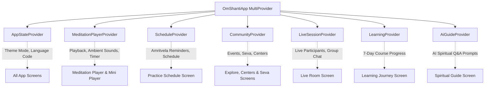

# Technology Stack Specification — Om Shanti (ॐ शान्ति)

> **Document Version:** 1.0.0  
> **Status:** Approved / Production Architecture  
> **Category:** Technical Infrastructure & Dependency Matrix  
> **Target SDK:** Flutter 3.13.2+ / Dart 3.1+

---

## 1. High-Level Technology Matrix

| Layer / Concern | Technology / Library | Version | Role in Project |
| :--- | :--- | :--- | :--- |
| **Framework** | **Flutter SDK** | `^3.13.2` | Multi-platform declarative UI engine compiling to native machine code. |
| **Language** | **Dart** | `^3.1.0` | Strongly typed language with sound null-safety and Ahead-Of-Time (AOT) compilation. |
| **State Management** | **Provider** | `^6.1.5+1` | Reactive, testable state management following unidirectional data flow. |
| **Local Storage** | **SharedPreferences** | `^2.5.5` | Fast key-value and JSON document persistence for offline-first resilience. |
| **Typography** | **Google Fonts** | `^8.2.1` | Curated spiritual typography (Outfit, Inter) loaded dynamically. |
| **Localization & Date**| **Intl** | `^0.20.3` | Date/time internationalization and number formatting across English & Hindi. |
| **Iconography** | **Cupertino Icons** | `^1.0.8` | Crisp system icons for iOS parity alongside Material Symbols. |
| **Design System** | **Material 3 (M3)** | Built-in | Modern Material design tokens, dynamic color schemes, and elevation. |
| **Code Quality & Linter**| **Flutter Lints** | `^6.0.0` | Strict static analysis enforcing Dart guidelines and immutability. |
| **Testing** | **Flutter Test** | SDK Built-in| Unit, widget, and mock integration test runner. |

---

## 2. Core Framework: Why Flutter & Dart?

### 2.1 The Rationale for Flutter
1. **Single Unified Codebase for All Platforms:**
   Meditation should be accessible on smartphones (Android & iOS), tablets, web browsers at home, and desktop computers. Flutter compiles directly to native ARM/x86 code and WebAssembly/HTML5 without bridge overhead.
2. **Custom Canvas & 60 FPS Visual Elegance:**
   Spiritual applications require deeply soothing visual transitions—such as the expanding golden radiance of Paramdham, breathing rhythm expanders, and aura gradients. Flutter's custom Skia/Impeller rendering pipeline provides consistent 60 FPS / 120 FPS frame rates without platform UI inconsistencies.
3. **Sound Null Safety & Reliability:**
   With Dart's sound null-safety, fatal runtime null pointer exceptions (`NullPointerException`) are eliminated at compile time, guaranteeing high stability for users during their meditation.

### 2.2 Comparison with Alternatives

| Feature | Flutter + Dart (Chosen) | React Native | Native Android (Kotlin) / iOS (Swift) |
| :--- | :--- | :--- | :--- |
| **Performance** | Native compiled binary; direct Skia/Impeller GPU canvas rendering. | JavaScript bridge / Hermes engine; occasional thread lag during animations. | Maximum raw platform performance, but requires 2x separate engineering teams. |
| **UI Consistency** | 100% pixel identical across Android, iOS, and Web. | Relies on OEM platform components, creating subtle visual discrepancies. | Platform-specific styling; requires duplicate styling systems. |
| **Offline Audio / Animations** | Highly responsive custom painters and micro-animations. | Bridge communication overhead on intensive canvas animations. | Excellent, but doubled engineering cost and maintenance. |

---

## 3. State Management: The Provider Pattern

### 3.1 Why Provider?
Rather than over-engineering with heavy boilerplate frameworks (like complex Redux or verbose Bloc boilerplate for every simple toggle), **Provider** was chosen because:
* **Pragmatic & Lightweight:** Official recommendation by the Flutter engineering team.
* **Granular UI Rebuilding:** Consumers (`Consumer<T>` or `context.select<T, R>()`) only rebuild the specific widget subtree listening to updated values.
* **Testable Separation:** State lives cleanly in `ChangeNotifier` classes, keeping presentation widgets purely declarative and decoupled from business logic.

### 3.2 Inventory of State Providers



* **`AppStateProvider`:** Controls global theme mode (Light / Paramdham Dark), active language (`en` vs `hi`), and active user profile state.
* **`MeditationPlayerProvider`:** Manages playback progress, play/pause state, sleep timers, bell chime intervals, and multi-track ambient audio layers.
* **`ScheduleProvider`:** Manages the user's daily meditation commitments, reminders, and Amritvela notifications.
* **`CommunityProvider`:** Handles event registrations, favorite centers, and Seva volunteer applications.
* **`LiveSessionProvider`:** Simulates live broadcast streams, real-time participant counts, and interactive chat messages.
* **`LearningProvider`:** Tracks completed lessons of the 7-Day Foundation Course and reflections.
* **`AiGuideProvider`:** Manages chat history and contextual spiritual recommendations.

---

## 4. Local Persistence & Offline-First Strategy

### 4.1 Technology: `SharedPreferences` + Structured JSON
For an app designed to be used in remote ashrams, flights, or quiet retreat rooms without Wi-Fi, **offline resilience is a non-negotiable requirement**.

* **Service Layer:** [`AppDatabaseService`](file:///c:/Users/princ/.gemini/antigravity-ide/scratch/omshanti/lib/data/app_database_service.dart) implements an asynchronous thread-safe singleton.
* **Serialized JSON Documents:** Complex states (User profile, daily spiritual charts, lesson progress) are modeled with strongly typed Dart objects and serialized to fast JSON key-value stores.
* **Zero Cold-Launch Latency:** Because `SharedPreferences` caches values in memory upon initialization, reads occur in microsecond time (`O(1)`), eliminating blank screens or loading spinners.

### 4.2 Persisted Data Keys
* `omshanti_user`: User profile, meditation stats, streak counts.
* `omshanti_favorites`: Set of bookmarked meditation session IDs.
* `omshanti_registered_events`: Set of registered retreat and seminar IDs.
* `omshanti_applied_seva`: Set of submitted volunteer applications.
* `omshanti_meditation_minutes`: Cumulative practice time in minutes.
* `omshanti_streak_days`: Consecutive daily meditation practice days.
* `omshanti_spiritual_charts_{YYYY-MM-DD}`: Daily Purusharth self-evaluation charts.
* `omshanti_murli_notes_{YYYY-MM-DD}`: Daily Murli churning and realization notes.
* `omshanti_completed_lessons`: IDs of completed 7-day course lessons.

---

## 5. Design System & Spiritual Brand Identity

### 5.1 Color Science (Brahma Kumaris Heritage)
The design system directly reflects the authentic visual language of the Brahma Kumaris spiritual tradition:

* **Primary Crimson Red (`#A92815`):** The iconic spiritual red representing Shiva Baba, the incorporeal Supreme Light and Ocean of Love.
* **Deep Spiritual Maroon (`#801809`):** Grounding contrast color for buttons and elevated headers.
* **Celestial Ocean Blue (`#0284C7`):** Represents the profound "Ocean of Peace" (*शान्ति का सागर*).
* **Paramdham Golden Aura (`#F59E0B` / `#D97706`):** Represents the incorporeal world of pure golden-red light (*परमधाम / शान्तिधाम*).
* **Pure Serene Ivory (`#FAF9F5`):** Clean, peaceful canvas echoing the traditional white attire of Rajyoga practitioners.
* **Cosmic Void Dark (`#0C0A10`):** Ultra-dark theme for Amritvela (4:00 AM) meditation in dark environments without eye strain.

### 5.2 Typography System
Configured using `google_fonts: ^8.2.1`:
* **Headings & Titles:** *Outfit* / *Playfair* — Modern, graceful, spiritually dignified sans-serif.
* **Body & Scriptures:** *Inter* — Exceptional readability across both Latin (English) and Devanagari (Hindi) scripts.

---

## 6. Internationalization & Localization Architecture

### 6.1 Custom Dynamic Localization Engine
Instead of relying on heavy `.arb` generation pipelines that require recompilation, **Om Shanti** utilizes a runtime-reactive localization dictionary:
* **`AppStrings`** provides an instant key-lookup mechanism (`AppStrings.get('key', langCode)`).
* Supports immediate UI language flipping between **English (`en`)** and **Hindi (`hi`)** without application restarts or route resets.
* Covers all modules: Meditation names, Murli sections, course lessons, center details, and error messages.

---

## 7. Build Configurations & Target Platforms

```
┌────────────────────────────────────────────────────────┐
│                   Om Shanti Client                     │
├─────────────────┬──────────────────┬───────────────────┤
│ Android         │ iOS              │ Web & Desktop     │
│ Min SDK: 21     │ Min iOS: 13.0    │ Modern Browsers   │
│ Target SDK: 34  │ Swift Runtime    │ WebAssembly / JS  │
│ Java 17         │ Xcode 15+        │ CanvasKit Engine  │
└─────────────────┴──────────────────┴───────────────────┘
```

---

## 8. Backend & Cloud Integration Roadmap

While the current architecture operates as an autonomous, offline-first client with local persistence and mock streaming, the codebase has been structured for immediate plug-and-play cloud integration:

* **Authentication:** Supabase Auth / Firebase Auth for cross-device cloud sync.
* **Database & Sync:** Cloud Firestore or Supabase PostgreSQL for syncing spiritual charts across phone and web.
* **Audio Streaming & CDN:** Cloudflare R2 / AWS S3 for streaming high-fidelity lossless meditation tracks and live audio feeds.
* **Push Notifications:** Firebase Cloud Messaging (FCM) for Punctual Amritvela and Traffic Control bells.
